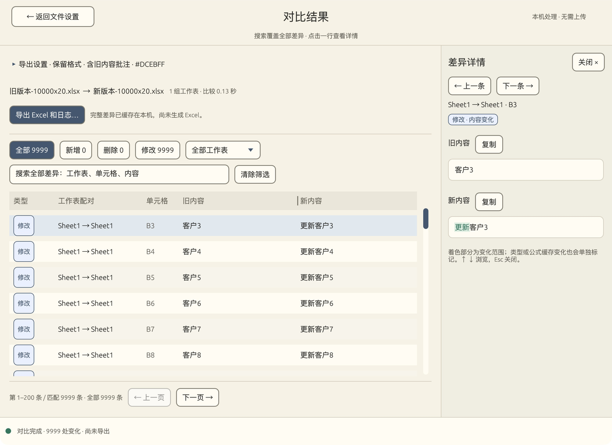

<p align="center">
  
</p>

<h1 align="center">Diff Excel</h1>
<p align="center">把两个版本的 Excel 放进来，看看哪里变了。</p>
<p align="center">
  <a href="https://github.com/zbuzhi/diff-excel/releases/latest">下载最新版</a> ·
  <a href="https://github.com/zbuzhi/diff-excel/issues">反馈问题</a> ·
  <a href="#在-git-中使用">Git difftool</a>
</p>

做表的人多了，文件名也慢慢变成了“最终版”“最终修改版”“这次真的是最终版”。想知道两个文件到底差在哪儿，靠来回切换窗口并不轻松。

Diff Excel 就是为这件事做的小工具。选好旧、新两个 `.xlsx` 文件，它会找出单元格内容和公式的变化，列出新增、删除和修改，需要时再导出一份带高亮的 Excel 报告。文件在电脑上处理，不需要上传，也不用注册账号。

2.1 可以先看结果，再决定要不要导出。搜索覆盖全部差异，长内容放在右侧详情里连续查看，文件选反了也能直接交换。

## 下载

| 系统 | 下载 | 说明 |
| --- | --- | --- |
| Windows x64 | [下载 ZIP](https://github.com/zbuzhi/diff-excel/releases/latest/download/DiffExcel-windows-x64.zip) | 解压后运行 `DiffExcel.exe`；包内也有命令行版本 |
| macOS Apple Silicon | [下载 DMG](https://github.com/zbuzhi/diff-excel/releases/latest/download/DiffExcel-macos-apple-silicon.dmg) | 适用于 M 系列芯片的 Mac |
| macOS Intel | [下载 DMG](https://github.com/zbuzhi/diff-excel/releases/latest/download/DiffExcel-macos-intel.dmg) | 适用于 Intel 芯片的 Mac |

不确定 Mac 的芯片型号，可以在苹果菜单的“关于本机”里查看。打开 DMG 后，把 **Diff Excel** 拖进 **Applications** 即可。

目前 Mac 安装包没有 Apple 开发者签名和公证。第一次打开可能需要到“系统设置 → 隐私与安全性”中允许打开。Windows 安装包也没有代码签名。

[所有版本与更新记录](https://github.com/zbuzhi/diff-excel/releases)。Linux 暂不提供安装包，可以从源码构建。

## 怎么用

1. 选择旧版本和新版本的 Excel，也可以把文件拖到对应卡片。选反了，点“交换旧／新版本”即可。
2. 同名工作表会自动配对；有需要再展开配对设置，手动调整名称不同的工作表。
3. 点击底部圆形的“开始对比”。完成后直接进入结果页，不用等 Excel 报告导出。
4. 按新增、删除、修改或工作表筛选，也可以搜索全部差异。点击一行，在右侧查看完整旧、新内容，通过“上一条／下一条”连续浏览。
5. 需要留档时，点击“导出 Excel 和日志”。高亮颜色、格式保留和旧内容批注都可以调整，修改这些选项不需要重新比较。

返回文件设置后，点“查看上次结果”可以接着看，搜索、筛选和位置都会保留。如果更换文件或调整配对，界面会提醒重新对比，避免把旧结果当成新结果。

输出目录、颜色和常用选项会记在本机，下次打开不用重新设置。最近文件也可以一键清空记录，不会删除原文件。

| 快捷键 | 操作 |
| --- | --- |
| `Cmd/Ctrl + Enter` | 开始对比 |
| `Cmd/Ctrl + F` | 搜索全部差异 |
| `↑` / `↓` | 浏览差异 |
| `Esc` | 关闭详情或选色窗口 |

### 操作演示

从开始对比、翻页和全量搜索，到查看变化详情、按需导出，一段动图看完。


<details>
<summary>展开查看界面截图</summary>

选择文件、检查工作表配对，并设置导出选项：


完整差异可以搜索和分页，右侧详情突出显示发生变化的文字：



高亮颜色可以自己选，也可以直接输入 HEX 色值：


</details>

## 导出的文件在哪里

点击导出后，默认保存在系统文档目录下的 `Diff Excel` 文件夹，也可以在界面里更改，软件会记住选择。每次导出都会新建一个独立目录，里面有：

- **`diff.xlsx`**：以新版本为基础的差异报告，变化的单元格会高亮；开启批注后，还能看到旧内容。
- **`changes.txt`**：完整差异日志，记录工作表、单元格位置及前后的内容。

原来的两个文件不会被修改，之前生成的报告也不会被覆盖。

## 使用前了解这几件事

- 目前支持 `.xlsx`，不支持旧的 `.xls` 和加密工作簿。
- 按单元格坐标比较，不会自动识别“整行移动”或“中间插了一行”。这类操作可能产生较多差异。
- 比较单元格的值、数据类型和公式，不把单纯的颜色、字体等样式调整算作内容变化。
- 不重新计算公式。公式文本或文件内保存的计算结果变化，都会计入差异。
- 搜索和筛选覆盖全部差异，列表按每页 **200 条**加载。结果会暂存在本机，只有点击导出才会生成 Excel 和完整日志。
- 处理时可以请求取消；读取文件或保存 Excel 时，需要等当前阶段结束后清理，不会强行中断文件写入。
- 保留格式时，以新工作簿为基础保留其他工作表和跨表引用；删除的工作表会另建报告页。复杂图表、透视表、外部链接等仍建议用自己的文件确认效果。


## 在 Git 中使用

如果 Excel 文件也放在 Git 里，可以把 Diff Excel 配成外部 diff 工具。Git 传入旧、新文件后，软件会自动加载它们。

macOS，假设已经安装到 Applications：

```sh
git config --global diff.tool diffexcel
git config --global difftool.diffexcel.cmd '"/Applications/Diff Excel.app/Contents/MacOS/diff-excel" "$LOCAL" "$REMOTE"'
git config --global difftool.prompt false

git difftool HEAD~1 HEAD -- '*.xlsx'
```

Windows，在 Git Bash 中配置，路径换成自己的安装位置：

```sh
git config --global diff.tool diffexcel
git config --global difftool.diffexcel.cmd '"C:/Tools/DiffExcel.exe" "$LOCAL" "$REMOTE"'
git config --global difftool.prompt false
```

也可以在图形 Git 客户端中设置外部比较工具，分别传入旧文件、新文件路径。命令需等待窗口关闭后再退出，方便 Git 清理临时文件。新增或删除文件的一侧支持 `/dev/null`、Windows `NUL` 和零字节占位文件。

## 命令行

不需要打开窗口时，可以直接生成报告：

```sh
diff-excel --headless "old.xlsx" "new.xlsx" --output ./reports
```

Windows ZIP 包中的独立命令行程序是 `diff-excel-cli.exe`：

```powershell
.\diff-excel-cli.exe --headless "old.xlsx" "new.xlsx" --output "C:\Reports"
```

可加 `--no-format` 不保留单元格格式，`--no-comments` 不添加旧内容批注，或用 `--color '#DCEBFF'` 指定高亮色。Windows 桌面版如果遇到显卡驱动问题，可尝试 `--software`；命令行版本不会初始化图形界面。

## 从源码运行

需要 Rust 1.89 或更高版本。克隆仓库后：

```sh
cargo run --locked

# 启动时加载两个文件
cargo run --locked -- "旧版本.xlsx" "新版本.xlsx"

# 仅构建命令行版本
cargo build --release --locked --no-default-features
```

Linux 桌面构建还需要系统库，例如 Ubuntu：

```sh
sudo apt-get install libgtk-3-dev libxkbcommon-dev libwayland-dev \
  libx11-dev libxrandr-dev libxi-dev libxcursor-dev libgl1-mesa-dev
```

本地检查：

```sh
cargo fmt --all -- --check
cargo test --locked --all-targets
cargo test --locked --no-default-features
cargo clippy --locked --all-targets -- -D warnings
```

推送 `v*` 标签后，GitHub Actions 会先运行检查，再构建 Windows 和两种架构的 Mac 安装包，上传到对应 Release。每个版本同时提供 `SHA256SUMS.txt` 校验文件。

## 反馈

遇到问题可以[提一个 Issue](https://github.com/zbuzhi/diff-excel/issues)。请尽量说明系统版本、操作步骤、预期结果和实际结果。如果方便，附一份去掉敏感数据的最小样本，会更容易复现。

## 许可证

[MIT](LICENSE)。Excel 读写基于 [umya-spreadsheet](https://github.com/MathNya/umya-spreadsheet)，桌面界面基于 [egui / eframe](https://github.com/emilk/egui)。
