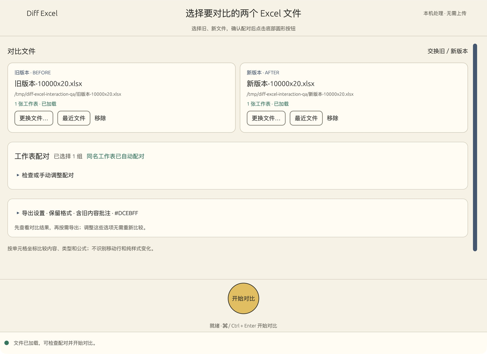
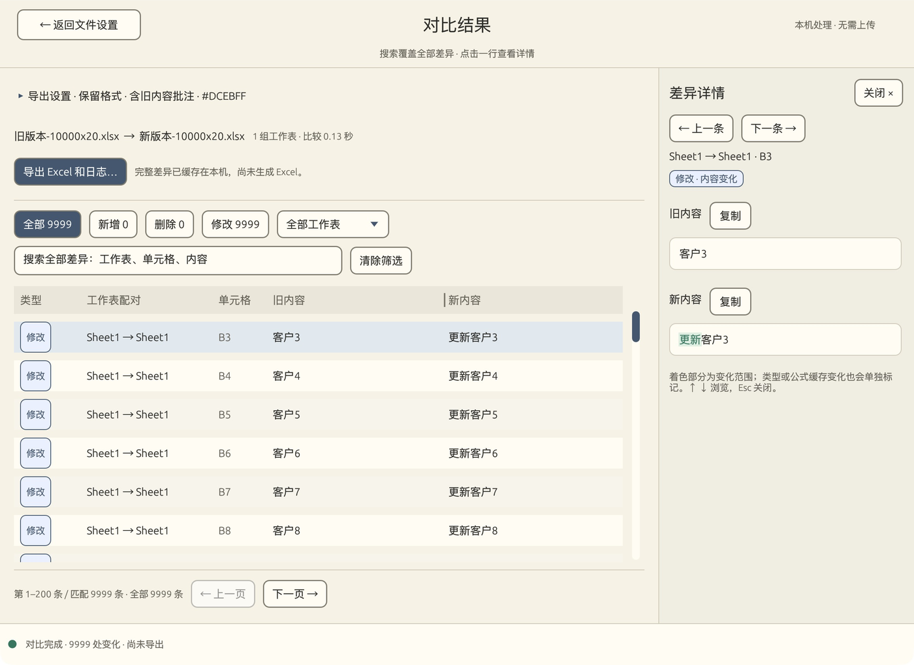

# v2.1.0：功能与交互优化

本页记录 v2.1.0 的功能、外观与交互更新，以及发布前的验证方法。

## 操作流程

选择旧、新文件 → 检查自动配对 → 点击底部圆形按钮 → 查看全部差异 → 按需导出 Excel 和日志。

- 可以把单个文件拖入对应的旧／新文件卡片，也可以一起拖入两个文件；选反时直接交换。
- 同名工作表自动配对。配对列表和手动配对默认折叠，单侧工作表会突出提示。
- 读取失败会清空对应侧，禁止使用上次文件继续对比；可重新选择或从最近记录恢复。
- 最近文件、输出目录、高亮色、格式和批注选项保存在本机。可以清空最近记录，不会删除文件。
- 比较阶段只生成本地临时差异缓存，不复制新工作簿、不自动导出 Excel。查看期间退出会释放结果缓存。
- 结果按每页 200 条加载。搜索、类型筛选和工作表筛选覆盖全部差异，没有 5,000 条搜索限制；搜索在后台执行并合并连续输入，过期结果不会覆盖新查询。
- 单击行在右侧查看完整内容，支持上一条／下一条、复制、文字变化范围高亮，以及类型／公式／计算结果变化说明。
- 拖动表头旧内容与新内容之间的分隔线，可调整两列宽度；长内容省略显示，悬停或详情中可查看。
- 返回设置、再查看上次结果时保留搜索、筛选和位置。文件或配对发生变化会明确提示结果过期；调整导出颜色、批注等选项不需要重新比较。
- 导出读取已经生成的差异缓存，修改导出选项后可以再次生成报告。命令行 `--headless` 仍一次生成 Excel 和完整日志。
- 读取、比较与导出均可请求取消。第三方库的文件解析和 Excel 写入不能在中途强行停止；界面会提示等待当前阶段完成，然后释放文件或清理尚未发布的报告。此前成功导出的报告不受影响。

快捷键：`Cmd/Ctrl+Enter` 开始对比，`Cmd/Ctrl+F` 搜索，`↑/↓` 浏览差异，`Esc` 关闭详情／选色窗口。

## 外观

保留奶油色、蓝灰色与底部圆形开始按钮。去掉卡片硬阴影，减轻边框，统一蓝色选中状态。结果摘要和导出选项更紧凑，正文空间留给列表和可调整宽度的详情面板。





## 验证记录

日期：2026-10-23，当前 macOS Apple Silicon 机器。

- `cargo fmt --all -- --check`、`cargo clippy --locked --all-targets -- -D warnings` 通过。
- `cargo test --locked --all-targets`：19 项通过，包含读取失败、取消读取、过期文件／搜索事件保护、超过 5,000 条的搜索和分页、取消导出清理、类型与公式、偏好恢复，以及原有 XML 命名空间、跨表引用、格式和原文件保护测试。
- 发布模式新生成 1 万行 × 20 列样本，含中文、数字和 9,999 个公式；两个版本有 9,999 处内容变化。
- 本机单次计时：读取约 0.648 秒，比较约 0.106 秒，搜索尾部记录约 0.007 秒，按需导出约 0.278 秒。计时不含样本生成、结果复核和桌面绘制，不能据此承诺其他机器或工作簿的表现，也不是与旧版的受控性能对照。
- 独立 Python ZIP/XML 校验逐项检查了 20 万个单元格的值、类型与公式，以及 9,999 个变化坐标、高亮、批注和日志。原始文件字节保持不变。
- 实际桌面窗口验证了开始快捷键、全量搜索 B10000、分页、连续详情、返回后保留查询、交换文件、最近文件加载、读取损坏文件时阻止对比、按需导出，以及取消第二次导出不留下新报告。已确认选色和最近路径写入本机偏好文件，并在重启后恢复颜色。
- Apple Silicon 桌面优化构建已生成并做本地签名校验；Windows 和 Intel Mac 本轮未做真机复测。

复现大文件验证：

```sh
cargo run --release --no-default-features --example interaction_benchmark -- /tmp/diff-excel-interaction-qa
python3 scripts/verify-interaction.py /tmp/diff-excel-interaction-qa
```

仍按单元格坐标比较，不包含按业务主键对齐或移动行识别。导出保留格式时仍需要构建一份输出工作簿；本轮减少的是查看阶段的工作簿复制，不保证所有导出场景的峰值内存都下降。
